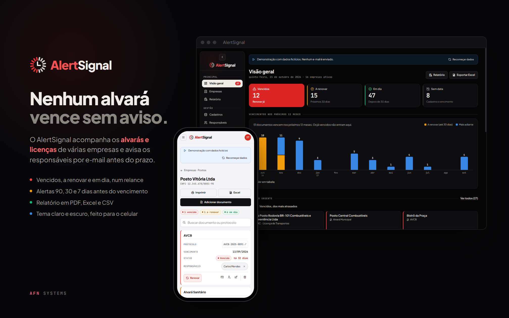
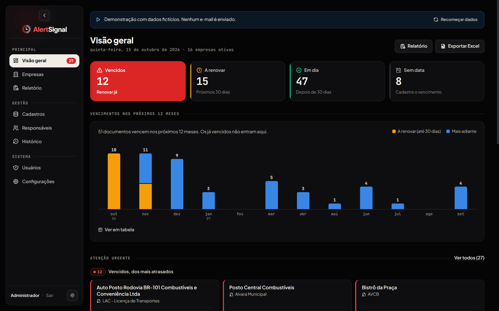
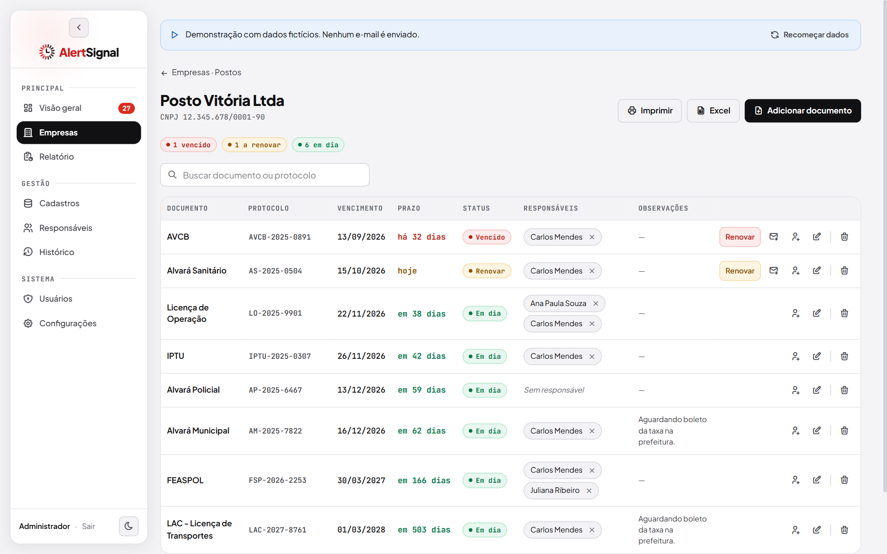
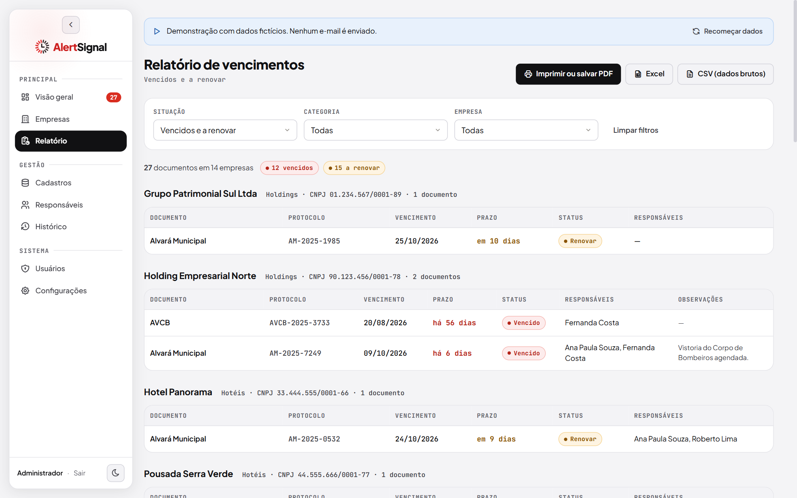
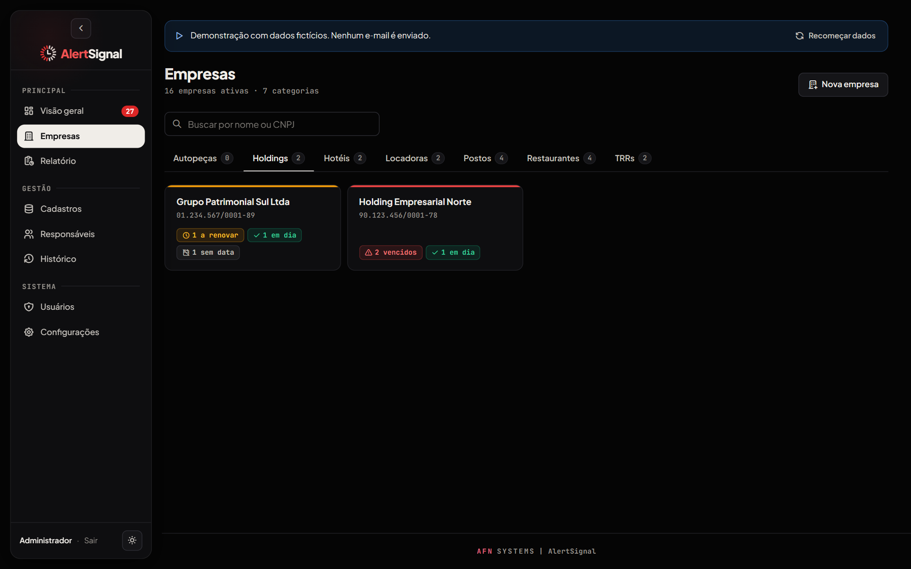
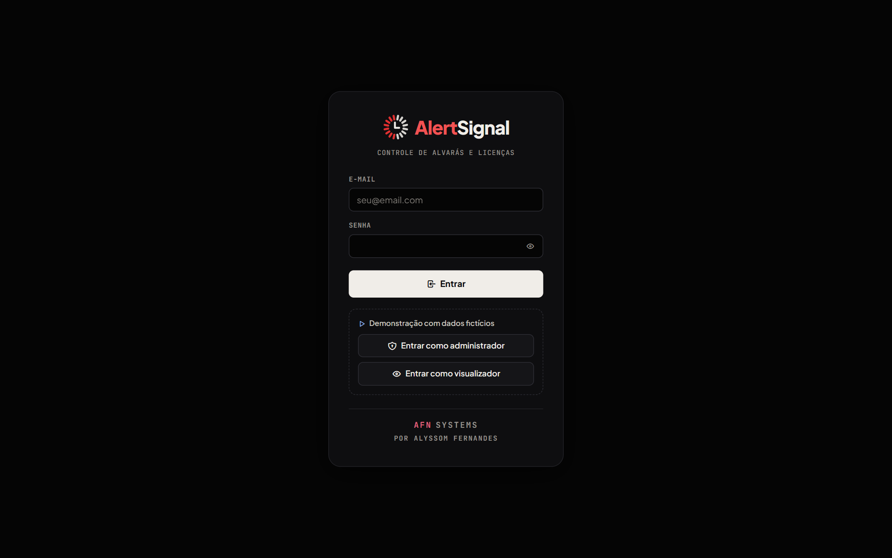
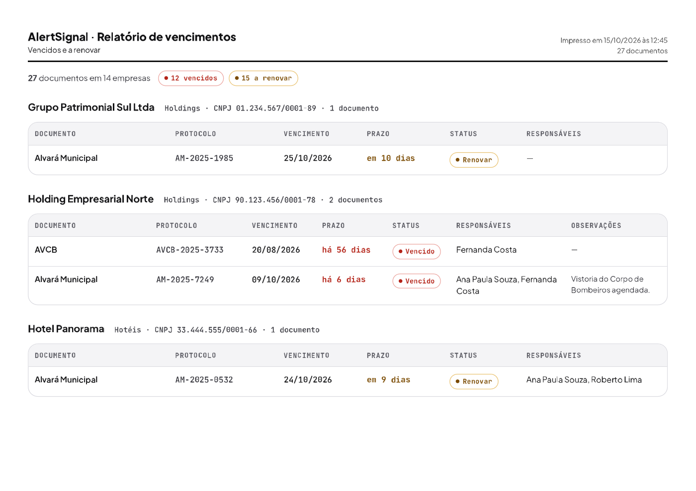
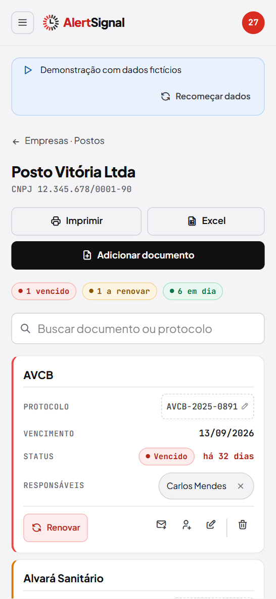
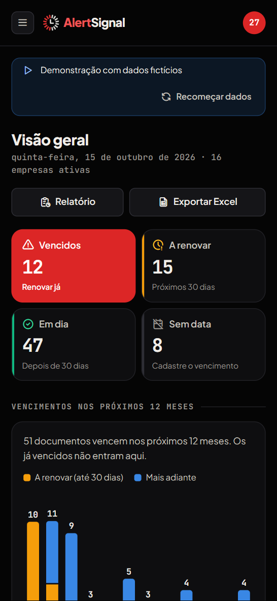

# AlertSignal



O AlertSignal acompanha os alvarás, licenças e documentos regulatórios de um
grupo de empresas e avisa os responsáveis por e-mail antes que algum vença.
Foi feito para um grupo de empresas que controlava essas datas numa planilha
mantida à mão. É pensado para rodar numa máquina da empresa, sem nuvem, e
guarda tudo num único arquivo SQLite.

[](https://github.com/alyssom-fernandes/AlertSignal/actions/workflows/testes.yml)


Este README também está em [inglês](README.md).

## Em 30 segundos

1. Rode a demonstração, com dados fictícios e sem enviar nenhum e-mail:
   ```bash
   pip install -r requirements.txt
   python app.py --demo
   ```
   No Windows, basta dar duplo clique em `DEMONSTRACAO.bat`: ele abre o navegador sozinho, na porta 5001.
2. Abra `http://localhost:5000` e clique em **Entrar como administrador**.
3. Na visão geral, abra um documento em **Atenção urgente**, renove e veja a
   linha mudar de lugar e o histórico registrar quem fez.
4. Em **Relatório**, escolha "Vencidos e a renovar" e use **Imprimir ou salvar PDF**.
5. Saia e entre como **visualizador**: tudo continua visível, mas só para consulta.

## Telas

Capturadas do modo demonstração. A faixa azul no alto de cada tela avisa que os dados são fictícios.

| Visão geral, tema escuro | Página da empresa, tema claro |
|---|---|
|  |  |
| **Relatório, tema claro** | **Empresas, tema escuro** |
|  |  |
| **Entrada, com os botões da demonstração** | **O relatório em PDF** |
|  |  |

| No celular, tema claro | No celular, tema escuro |
|---|---|
|  |  |

---

## Funcionalidades

- **Alertas automáticos por e-mail.** Uma verificação roda todo dia num horário configurável. Cada documento recebe um aviso quando faltam 90, 30 e 7 dias para o vencimento (os três prazos são configuráveis) e um lembrete por dia depois que vence. Cada aviso sai uma vez para cada responsável: rodar duas vezes no mesmo dia não repete nada; um documento cadastrado já dentro de uma faixa, ou um marco que passou num dia sem verificação, recebe o aviso mais recente na verificação seguinte; e um documento renovado recomeça com a nova data. Se o e-mail de um aviso falhar, ele volta no dia seguinte. O e-mail agrupa os documentos por urgência e tem versão em texto simples.
- **Várias empresas e categorias.** Cada empresa tem os próprios documentos, e as categorias organizam por ramo (postos, restaurantes, hotéis...).
- **Mais de um responsável por documento**, para nenhum alerta depender de uma pessoa só.
- **Renovação, edição e protocolo na própria tela da empresa**, com o histórico registrando quem fez o quê.
- **Relatório de vencimentos** com filtros por situação, categoria e empresa, impressão em paisagem e "salvar como PDF".
- **Exportação** para Excel formatado (cores por situação, filtro, totais, pronto para imprimir) e para CSV com ponto e vírgula, que o Excel em português abre direto em colunas.
- **Gráfico dos vencimentos dos próximos 12 meses**, com dica ao passar o mouse e versão em tabela.
- **Dois níveis de acesso.** Administradores alteram; visualizadores só consultam, e o servidor também bloqueia.
- **Tema escuro e claro**, que segue o sistema na primeira visita, e layout para celular.
- **Funciona sem internet.** Fontes e ícones são servidos pelo próprio sistema, sem carregar nada de terceiros.
- **Modo demonstração** com dados fictícios, num banco separado.

---

## Como rodar

### Requisitos

- Python 3.11 ou superior (os testes rodam no 3.11 e no 3.13)

### Demonstração (dados fictícios)

```bash
pip install -r requirements.txt
python app.py --demo
```

Abra `http://localhost:5000` e use os botões **Entrar como administrador** ou **Entrar como visualizador**. A demonstração grava num `demo.db` separado, recriado a cada início, e não envia nenhum e-mail. No Windows, o `DEMONSTRACAO.bat` faz o mesmo na porta 5001, para rodar ao lado de uma instalação real na 5000, e abre o navegador sozinho.

### Uso real

1. Copie o `.env.example` para `.env` e defina uma `SECRET_KEY` longa e aleatória. Se quiser, defina também `ADMIN_EMAIL` e `ADMIN_SENHA` para o primeiro administrador.
2. Rode `python app.py` (ou dê duplo clique em `INICIAR.bat` no Windows).
3. Na primeira execução, o console mostra o e-mail do administrador e, se `ADMIN_SENHA` não estiver definida, uma senha aleatória que só aparece dessa vez. Entre e troque a senha em **Meu perfil**.

Os dados ficam em `zen.db`, que não vai para o git. Se houver uma planilha `planilha.xlsx` na pasta, ela é importada na primeira execução.

O servidor atende em todas as interfaces de rede, para os outros computadores da empresa abrirem o sistema. Com `HOST=127.0.0.1` no `.env`, ele fica restrito a esta máquina.

> **Atualizando uma instalação feita a partir de um clone antigo:** versões anteriores guardavam o `zen.db` no repositório. Antes do `git pull`, faça uma cópia do `zen.db` e, se o git recusar a atualização por causa dele, restaure a cópia depois do pull. Nunca use `git reset --hard` ou `git checkout -- zen.db` nessa máquina sem a cópia.

### Testes

```bash
python -m unittest discover -s tests -v
```

Os mesmos testes rodam no GitHub Actions a cada envio. Eles usam o modo demonstração, num banco temporário, e cobrem as páginas, as permissões do visualizador, a proteção contra CSRF, o bloqueio de entrada, os cabeçalhos de segurança, a queda da sessão de quem é excluído, desativado ou tem a senha redefinida, as exportações (inclusive contra fórmulas injetadas na planilha), o e-mail de alerta, as regras dos alertas numa data fixa (cada marco, a não repetição, o lembrete diário depois de vencido e os prazos configuráveis) e o agendador.

---

## Configuração do e-mail

O AlertSignal envia pelo Gmail com uma senha de app.

1. Em [myaccount.google.com](https://myaccount.google.com), ative a verificação em duas etapas.
2. Procure **Senhas de app** e crie uma chamada "AlertSignal".
3. No AlertSignal, abra **Configurações**, preencha o e-mail e a senha de app e salve.
4. Use **Enviar teste** para conferir.
5. Opcional: informe o **Endereço do sistema** na rede (ex.: `http://192.168.0.10:5000`) para o e-mail ganhar o botão "Abrir no AlertSignal".

---

## Tecnologias

| Camada | Tecnologia |
|---|---|
| Servidor | Python 3 + Flask |
| Banco de dados | SQLite |
| Agendador | APScheduler |
| E-mail | smtplib + Gmail (SSL) |
| Interface | Jinja2, CSS e JavaScript sem framework |
| Fontes e ícones | Plus Jakarta Sans, JetBrains Mono e Tabler Icons, servidos pelo próprio sistema |
| Planilhas | openpyxl (exportação) e pandas (importação) |

---

## Decisões técnicas

**SQLite em vez de PostgreSQL.** É uma aplicação local, numa máquina só e com poucas escritas. SQLite não pede configuração, e o backup é copiar um arquivo.

**APScheduler em vez de cron.** Roda dentro do processo do Flask, funciona no Windows e deixa o horário do envio ser trocado pela própria tela.

**SQL direto, sem ORM.** Consultas parametrizadas, explícitas e curtas. Com nove tabelas, um ORM só acrescentaria camadas.

**JavaScript sem framework.** Modais com `<dialog>`, edição na linha, filtros e avisos cabem em poucas funções. O gráfico é feito com HTML e CSS e continua legível no celular.

**Proteção contra CSRF sem dependência.** Um token por sessão vai em todo formulário e em todo `fetch` que altera dados.

**Segurança sem pacotes extras.** A cada pedido, o usuário conectado é relido do banco: quem é excluído, desativado ou tem a senha redefinida sai no pedido seguinte. Cinco senhas erradas para o mesmo e-mail bloqueiam a entrada por 15 minutos, toda resposta leva cabeçalhos de segurança (CSP, X-Frame-Options, nosniff, Referrer-Policy) e o texto exportado que começa com `=`, `+`, `-` ou `@` continua texto no Excel, em vez de virar fórmula.

---

## Estrutura do projeto

```
alertsignal/
├── app.py                  # Rotas, permissões, relatório e exportações
├── database.py             # Esquema do SQLite e conexão
├── notificacoes.py         # Regras dos alertas e envio de e-mail
├── demo_seed.py            # Dados fictícios do modo demonstração
├── importar_planilha.py    # Importação da planilha antiga (uma vez)
├── tests/                  # Testes (unittest): rotas e segurança, regras dos alertas e agendador
├── .github/workflows/      # Testes no GitHub Actions a cada envio
├── docs/telas/             # Imagens deste README e da prévia de link
├── INICIAR.bat             # Inicia o sistema no Windows
├── DEMONSTRACAO.bat        # Inicia a demonstração no Windows
├── .env.example            # Configurações do uso real (copie para .env)
├── static/
│   ├── css/app.css         # Estilos, temas, celular e impressão
│   ├── js/app.js           # Modais, confirmações, abas, tema e menu
│   ├── img/                # Imagem da prévia de link
│   └── vendor/             # Fontes e ícones servidos localmente, com as licenças
└── templates/              # Páginas Jinja (layout, telas, relatório e erros)
```

---

## Banco de dados

```
usuarios              usuários do sistema (login e nível)
categorias            ramos das empresas
empresas              empresas, com CNPJ, categoria e situação (ativa ou inativa)
documentos            documentos de cada empresa (tipo, protocolo, vencimento, situação)
responsaveis          pessoas que recebem os alertas
documento_responsavel quem responde por cada documento
historico             alertas enviados e alterações, com data e autor
alerta_enviado        avisos já enviados (documento, responsável, marco, vencimento, dia)
configuracoes         e-mail, horário e prazos dos alertas
```

---

## Limitações conhecidas

- A senha de app do Gmail fica em texto no banco. Para uso fora da rede da empresa, o caminho seria cifrar com `cryptography.fernet`.
- O servidor embutido do Flask atende bem a rede local; para acesso pela internet, o certo é colocar atrás de um servidor como Waitress ou Gunicorn, com HTTPS, e definir `ALERTSIGNAL_HTTPS=1` para o cookie de sessão só trafegar por HTTPS.
- A contagem do bloqueio de entrada fica na memória: reiniciar o servidor a zera.

---

## Licença

[MIT](LICENSE).

---

## Autor

Desenvolvido por **Alyssom Fernandes**. Primeiro projeto em Python, feito para um grupo de empresas que controlava esses documentos numa planilha e para mostrar o trabalho de ponta a ponta: regras de negócio, banco de dados, tarefas agendadas, e-mail e interface.
